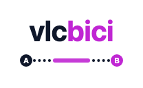
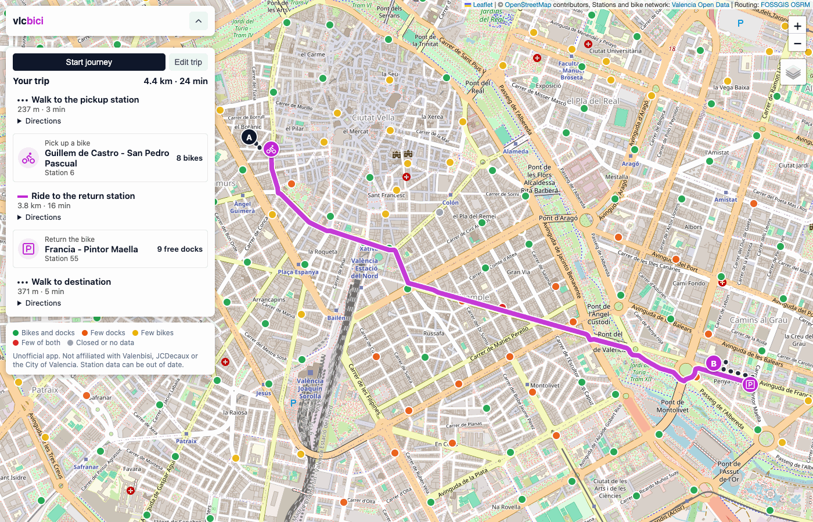

<p align="center"></p>

# vlcbici

A small static web app that plans a trip in Valencia with walking and Valenbisi bike sharing.



> [!NOTE]
> This is an unofficial project. It is not affiliated with, endorsed by or connected to Valenbisi, JCDecaux or the City of Valencia. "Valenbisi" is used only to name the bike sharing service that the app works with. Station data comes from the city's public open data and can be out of date. Check the station before you rely on it.

## What it does

1. You enter a start and a destination. You can type an address, click the map, or use your current location for the start.
2. The app loads live Valenbisi station data.
3. It selects the pickup station: the nearest station to the start with 3 or more available bikes.
4. It selects the return station: the nearest station to the destination with 3 or more free docks.
5. It requests three routes at the same time:
   - walk from the start to the pickup station,
   - ride from the pickup station to the return station,
   - walk from the return station to the destination.
6. It shows the routes on the map (walking as dark dots, bike as a solid magenta line), a summary with distance and time per leg, and turn-by-turn directions.

If the pickup and return stations are the same, or if walking to and from the stations is longer than walking directly, the app shows only a walking route.

The app rejects a start or destination that is more than 2 km from every Valenbisi station.

The app ignores stations that are closed or that did not report data in the last 2 hours.

The map shows all stations as small circles:

| Colour | Meaning                                        |
| ------ | ---------------------------------------------- |
| Green  | 3+ bikes and 3+ free docks                     |
| Orange | 3+ bikes, fewer than 3 free docks              |
| Yellow | 3+ free docks, fewer than 3 bikes              |
| Red    | fewer than 3 bikes and fewer than 3 free docks |
| Grey   | closed or no recent data                       |

Map clicks fill the empty field: first the start, then the destination. When both fields are filled, the next click starts again.

A station popup has "Start" and "Destination" buttons. Use them when a station covers the spot that you want to click, or when you want a specific station:

- "Start" makes this the pickup station. The trip then begins with a walk from your live location to the station, if the app knows your location. Otherwise the trip begins at the station.
- "Destination" makes this the return station. The trip ends at the station, without a last walk.

The app keeps a station that you picked, even if it has fewer than 3 bikes or free docks, and shows a warning.

Map clicks and the "Start" and "Destination" buttons work only while the form is open.

## Start the journey

After a plan, the form closes. The trip has two buttons:

- "Start journey" starts the ride. The map follows your live location until you drag the map. "Follow me" turns this on again.
- "Edit trip" opens the form again. The current trip stays on the map until you plan a new trip or click "Clear".

During the journey, a station popup has "Pick up here" and "Return here" buttons. They plan the trip again with this station:

- "Pick up here" makes this the pickup station. The trip then begins with a walk from your live location to the station, if the app knows your location.
- "Return here" makes this the return station. The walk to your destination starts from the new station.

During a bike trip, the app loads the station data again every minute. If the pickup station has fewer than 3 bikes, or the return station has fewer than 3 free docks, the app shows a message.

"End journey" removes the trip and opens an empty form.

## Install as an app

You can install vlcbici on your phone or computer:

- In Chrome or Edge, use the install icon in the address bar, or the menu item "Install app" or "Add to Home screen".
- In Safari on iPhone or iPad, use Share > "Add to Home Screen".

Without a connection, the app opens and shows "no internet connection".

The app does not keep station data, routes, addresses, the city bike network or map tiles. These always come live from the services, so the app never shows old data as current.

When the app comes back after a minute or more in the background, it loads the station data again.

## Data sources

- Station availability: [Valenbisi disponibilidad, Valencia Open Data](https://opendata.vlci.valencia.es/en/dataset/valenbisi-disponibilitat-valenbisi-dsiponibilidad), loaded live from the city geoportal (GeoJSON).
- Map tiles: [OpenStreetMap](https://www.openstreetmap.org/copyright), © OpenStreetMap contributors.
- "Cycling map (OpenStreetMap)" map style (switch with the layer button at the top right): [CyclOSM](https://www.cyclosm.org/), hosted by OpenStreetMap France. It shows bike lanes, cycle tracks and bike parking.
- "Bike network (City of Valencia)" map style: [Itinerarios Ciclistas, Valencia Open Data](https://opendata.vlci.valencia.es/dataset/itinerarios-ciclistas-itineraris-ciclistes), drawn over the street map with a legend. It also marks sections closed for works. The app loads it (about 350 kB) only when you choose this map style.
- Routing: [OSRM on OSM data by FOSSGIS](https://routing.openstreetmap.de/) (foot and bike profiles).
- Geocoding: [Nominatim](https://nominatim.openstreetmap.org/). The app sends at most one search per second, only when you click "Plan route", and keeps each result until you change the text. It sends no search while you type.
- Map library: [Leaflet 1.9.4](https://leafletjs.com/).

## How to run

The app has no build step and no backend. The browser loads the JavaScript files in `src/` as native ES modules. Serve the folder with any static web server:

```sh
python3 -m http.server 8000
```

Then open <http://localhost:8000>.

Do not open `index.html` directly from disk (`file://`). Browsers do not load ES modules from disk, so the app does not start. Also, the browser then sends no `Referer` header, and the OpenStreetMap tile server blocks tile requests without it. Privacy extensions that strip the `Referer` cause the same problem. See <https://wiki.openstreetmap.org/wiki/Blocked_tiles>.

"Use my location" needs `localhost` or HTTPS, because browsers allow geolocation only in a secure context.

The service worker (`sw.js`) also works only on `localhost` or HTTPS. It loads the app files from the network first, so code changes show on a normal reload. To test offline, use DevTools > Application > Service workers > Offline. If you serve other projects on the same `localhost` port, unregister the service worker there.

## Run the tests

The unit tests cover the pure logic: station selection, the walk-only decision, the GeoJSON parser and the text formats. A test also checks that `sw.js` lists every file in `src/` and the Leaflet files. The tests use the Node.js test runner and need no packages. Node.js 18 or newer is necessary.

```sh
npm test
```

You can also run `node --test` directly.

## Project structure

- `index.html`: page layout. It loads Leaflet, then `src/main.js` as a module.
- `style.css`: styles, including the mobile layout.
- `src/main.js`: connects the page events to the modules and starts the app.
- `src/config.js`: data URLs, limits and line styles.
- `src/stations.js`: station data, distances and station selection. No DOM, no Leaflet.
- `src/format.js`: text for distances, times, ages and directions. No DOM, no Leaflet.
- `src/api.js`: network calls for stations, geocoding and routes.
- `src/state.js`: the app state that more than one module uses.
- `src/panel.js`: the panel elements, the status message and the trip mode.
- `src/render.js`: HTML for the station popups and the trip summary.
- `src/map.js`: the Leaflet map, the map styles, the city bike network and the map layers.
- `src/points.js`: the start and destination points, from map clicks and station popups.
- `src/location.js`: "Use my location" and the live location dot.
- `src/trip.js`: trip planning and "Edit trip".
- `src/journey.js`: the journey: follow the location, refresh the stations, change a station. Also "Clear" and "End journey".
- `sw.js`: the service worker. It keeps the app files for an offline start and never keeps live data. Add each new file in `src/` to `APP_FILES`.
- `manifest.webmanifest`: app name, colours and icons.
- `icons/`: `icon.svg` (the source and the favicon) and the PNG files made from it. To make them again on macOS, run `sips -s format png -z 512 512 icons/icon.svg --out icons/icon-512.png`, then the same command with 192. iOS keeps the old home screen icon until the user adds the app again.
- `test/`: unit tests for `src/stations.js` and `src/format.js`, and the file list in `sw.js`.

## License

The code is under the [MIT License](LICENSE). It does not cover the data that the app loads:

- Map data: © OpenStreetMap contributors, under the [ODbL](https://www.openstreetmap.org/copyright).
- Station availability and bike network: Valencia Open Data, under [CC BY 4.0](https://creativecommons.org/licenses/by/4.0/).
